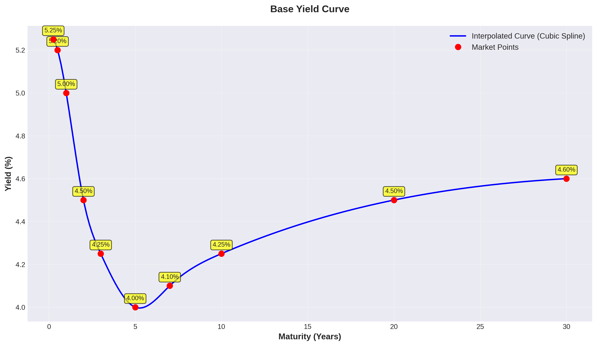
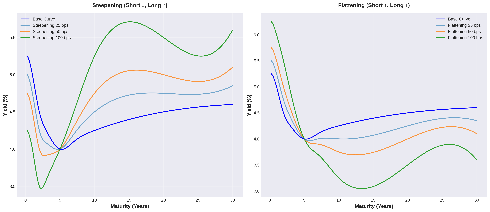
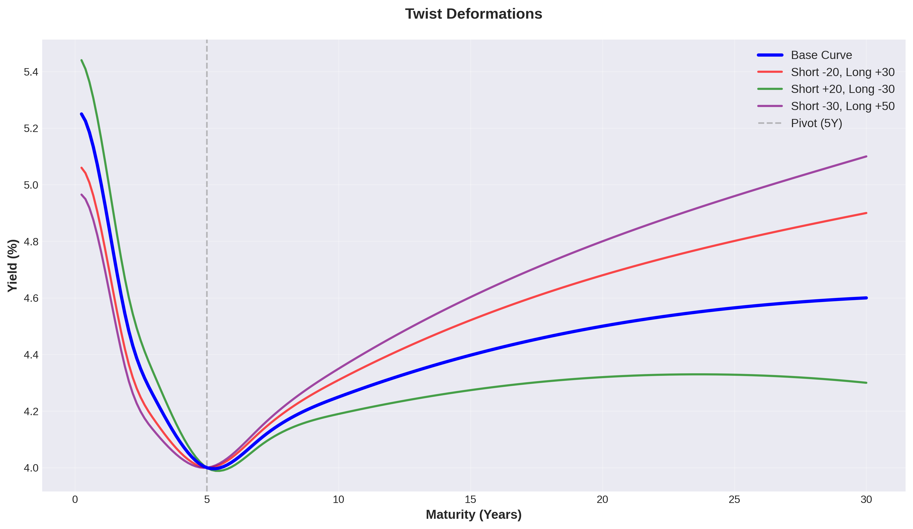
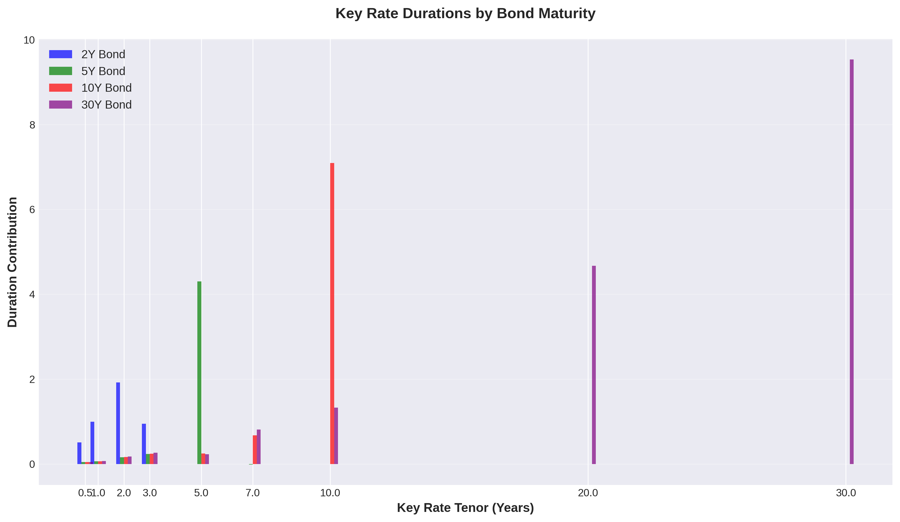

# Yield Curve Deformation Simulator

A Python toolkit for simulating yield curve movements and analyzing fixed income risk metrics. Supports parallel shifts, steepening, flattening, twists, and butterfly deformations with comprehensive duration, DV01, and convexity calculations.

## Comprehensive Documentation and Visualizations

This toolkit simulates yield curve movements and calculates comprehensive risk metrics for fixed income securities. The following visualizations and explanations demonstrate how various yield curve deformations function and their impact on bonds and portfolios.

## Features

- **Yield Curve Modeling**
  - Multiple interpolation methods (cubic spline, PCHIP, linear)
  - Forward rate and discount factor calculations
  - Par rate derivation
  - Slope and curvature analytics

- **Curve Deformations**
  - Parallel shifts
  - Steepening / Flattening
  - Twist movements
  - Butterfly spreads (positive and negative)
  - Bear/Bull steepener and flattener scenarios
  - PCA-based deformations (level, slope, curvature)
  - Custom point-by-point deformations

- **Risk Metrics**
  - Macaulay Duration
  - Modified Duration
  - Effective Duration
  - DV01 (Dollar Value of 01)
  - Convexity and Effective Convexity
  - Key Rate Durations
  - Partial Durations
  - Value at Risk (VaR)
  - Expected Shortfall

- **Portfolio Analytics**
  - Aggregate portfolio risk metrics
  - Duration contribution analysis
  - Scenario P&L attribution

### Visualizations and Interpretations

#### 1. Base Yield Curve



**What This Visualization Shows:**
- The base yield curve displays yields across various maturities from 3 months to 30 years
- Red points represent original market data
- The blue line is the cubic spline interpolation between data points

**Interpretation:**
- The curve is nearly flat with a slightly inverted shape in the short end (5.25% at 3M → 4.00% at 5Y)
- The long end rises slightly (4.00% at 5Y → 4.60% at 30Y)
- The 2s10s spread is -0.25 bps, indicating a very flat curve
- This shape suggests market expectations of stable or declining interest rates

---

#### 2. Parallel Shift


**What This Visualization Shows:**
- Parallel shifts of the entire yield curve by various amounts (-50, -25, +25, +50 basis points)
- All maturities are shifted by the same amount

**Interpretation:**
- Green (-50/-25 bps): Declining rates → Bond prices rise → Positive for bondholders
- Orange/Red (+25/+50 bps): Rising rates → Bond prices fall → Negative for bondholders
- This simulates central bank policy affecting all rates uniformly
- Relevant for duration and DV01 calculations

---

#### 3. Steepening & Flattening



**What This Visualization Shows:**
- **Left (Steepening)**: Short rates decline, long rates rise → Curve steepens
- **Right (Flattening)**: Short rates rise, long rates decline → Curve flattens

**Steepening Interpretation:**
- The yield curve steepens as the spread between short and long rates increases
- Typical during economic recovery phases
- Short-dated bonds benefit, long-dated bonds underperform
- Banks profit (borrow short-term cheaply, lend long-term at higher rates)

**Flattening Interpretation:**
- The yield curve flattens as the spread decreases
- May signal an impending recession
- Long-dated bonds benefit relative to short-dated bonds
- Typical when central banks raise rates (short end rises faster)

---

#### 4. Twist Deformations



**What This Visualization Shows:**
- Independent movements of the short and long ends of the yield curve
- Pivot point at 5 years (gray dashed line)
- Various scenarios: short end ↓/↑ while long end ↑/↓

**Interpretation:**
- **Red (Short -20, Long +30)**: Most aggressive steepening → Short end falls sharply, long end rises sharply
- **Green (Short +20, Long -30)**: Most aggressive flattening → Opposite movement
- **Purple (Short -30, Long +50)**: Extreme steepening with very strong movements
- Twist scenarios are realistic during mixed central bank signals or changes in inflation expectations

---

#### 5. Butterfly Spreads


**What This Visualization Shows:**
- **Left (Positive Butterfly)**: Wings rise, belly falls → Curve becomes more convex
- **Right (Negative Butterfly)**: Wings fall, belly rises → Curve becomes more concave

**Positive Butterfly Interpretation:**
- Short and long-term ends rise, intermediate maturities fall
- The curve exhibits increased curvature
- Intermediate maturity bonds (5-10Y) benefit relatively
- Trading strategy: Long intermediate maturities, short short and long maturities

**Negative Butterfly Interpretation:**
- Intermediate maturities rise, wings fall
- The curve becomes smoother
- Short and long-term bonds benefit
- Trading strategy: Short intermediate maturities, long short and long maturities

---

#### 6. Bear/Bull Scenarios


**What This Visualization Shows:**
Four macroeconomic scenarios:

**Bear Steepener (top left):**
- Long end rises (+40 bps)
- Short end remains stable
- **Interpretation**: Rising inflation expectations, overheating economy, long-term bonds are sold off

**Bull Steepener (top right):**
- Short end falls (-50 bps)
- Long end remains stable
- **Interpretation**: Central bank cuts rates (recession concerns), but long rates remain stable

**Bear Flattener (bottom left):**
- Short end rises (+30 bps)
- Long end remains stable
- **Interpretation**: Central bank aggressively raises rates to combat inflation

**Bull Flattener (bottom right):**
- Long end falls (-30 bps)
- Short end remains stable
- **Interpretation**: Recession expectations, flight-to-quality into long-term government bonds

---

#### 7. Key Rate Durations



**What This Visualization Shows:**
- Sensitivity of different bonds to rate changes at specific maturity points
- Four different bonds: 2Y, 5Y, 10Y, 30Y

**Interpretation:**
- **2Y Bond (blue)**: Highest sensitivity at 2Y rates, minimal sensitivity at long maturities
- **5Y Bond (green)**: Broadly distributed, maximum at 5Y
- **10Y Bond (red)**: Very high concentration at 10Y (bar ~7.0), dominant factor
- **30Y Bond (purple)**: Would show extreme sensitivity at 30Y (not fully visible due to scaling)

**Practical Significance:**
- Identifies which parts of the yield curve present the greatest risk for a position
- Critical for hedging strategies: allows targeted hedges at relevant key rates
- Portfolio managers use this for constructing immunization strategies

---

#### 8. Scenario Analysis


**What This Visualization Shows:**
- Price changes for a 10-year bond (4% coupon) under various rate scenarios
- Left: Absolute price change in dollars
- Right: Percentage price change

**Scenario Interpretation:**
- **Parallel -50 bps** (green): Largest gain (~+$20.55, +2.1%) → Rates fall sharply
- **Parallel -25 bps** (green): Moderate gain → Rates fall moderately
- **Parallel +25 bps** (red): Moderate loss (~-$20.08, -2.05%) → Rates rise moderately
- **Parallel +50 bps** (red): Larger loss → Rates rise sharply
- **Steepening** (red): Loss (~-$34, -3.48%) → Long rates rise sharply, hits 10Y bond hard
- **Flattening** (green): Gain (~+$35.74, +3.66%) → Long rates fall, very positive for 10Y bond
- **Butterfly** (red): Moderate loss (~-$16.48, -1.69%) → Intermediate maturities suffer

**Practical Significance:**
- Demonstrates asymmetric risk: Flattening offers more upside than steepening downside
- Critical for risk management and Value-at-Risk calculations
- Guides hedging decisions for specific positions

---

#### 9. Duration and Convexity by Maturity


**What This Visualization Shows:**
Three key risk metrics across different maturities:

**Modified Duration (left):**
- Increases from ~1 year (1Y bond) to ~15 years (30Y bond)
- Non-linear growth: flattens at longer maturities
- **Interpretation**: Duration measures percentage price change for 1% rate change
  - 10Y Bond: ~8.14 duration → At +1% rates, price falls ~8.14%
  - 30Y Bond: ~15 duration → At +1% rates, price falls ~15%

**Convexity (center):**
- Rises exponentially from ~5 (1Y) to ~350 (30Y)
- Strongly accelerated growth at long maturities
- **Interpretation**: Convexity measures the curvature of the price-yield relationship
  - Positive convexity is advantageous: prices rise more when rates fall than they decline when rates rise
  - Higher convexity provides better asymmetric payoff structure

**DV01 (right):**
- Dollar Value of 01 Basis Point
- Increases from ~$0.10 (1Y) to ~$1.50 (30Y)
- **Interpretation**: Direct dollar loss from 1 basis point rate increase
  - 10Y Bond: ~$0.81 DV01 → At +1bp, the $1000 bond loses $0.81
  - 30Y Bond: ~$1.50 DV01 → Higher absolute risk

**Practical Significance:**
- Portfolio managers use these metrics for risk control
- Long bonds carry higher interest rate risk but also higher convexity benefits
- Trade-off between yield pickup and interest rate risk

---

#### 10. Portfolio Analysis


**What This Visualization Shows:**
A portfolio with four positions (Total value ~$504K):
- 100x 2Y Bonds (3.5% coupon)
- 200x 5Y Bonds (4.0% coupon)
- 150x 10Y Bonds (4.5% coupon)
- 50x 30Y Bonds (5.0% coupon)

**Left - Duration Contribution:**
- **2Y Bond**: 0.37 duration (5.9% of total risk) → Smallest contribution
- **5Y Bond**: 1.78 duration (28.4%) → Second largest contribution
- **10Y Bond**: 2.43 duration (38.8%) → Largest risk contribution despite moderate weighting
- **30Y Bond**: 1.68 duration (26.9%) → High duration but low quantity

**Interpretation:**
- The 10Y position dominates portfolio interest rate risk
- Despite lower quantity than 5Y bonds, 10Y has more than double the duration contribution
- Portfolio is "bullet"-shaped, centered around 10Y

**Right - Scenario P&L:**
Various rate scenarios and their portfolio impact:
- **Parallel +50** (red): ~-$10.7K loss → Rising rates damage portfolio
- **Parallel -50** (green): ~+$10.9K gain → Falling rates benefit portfolio
- **Steepening** (red): ~-$7.7K loss → Long end rises, severely impacts 10Y and 30Y positions
- **Flattening** (green): ~+$8.0K gain → Long end falls, benefits 10Y and 30Y positions
- **Bear Steep** (red): ~-$3.7K loss → Moderate loss from rising long rates
- **Bull Flat** (green): ~+$2.7K gain → Moderate gain from falling long rates

**Interpretation:**
- Portfolio is long-positioned (benefits from falling rates)
- Asymmetric profile: Flattening offers more upside than steepening downside
- Steepening is the most dangerous scenario after parallel rate increases
- Portfolio would benefit from a recession (bull flattening) environment

---

## Summary: What Does the Script Do?

The `basic_usage.py` script demonstrates the core functionality of the Yield Curve Simulator:

1. **Yield Curve Modeling**: Creates realistic yield curves with cubic spline interpolation
2. **Deformation Scenarios**: Simulates 7 different types of yield curve movements
3. **Individual Security Risk Metrics**: Calculates Duration, Convexity, DV01, and Key Rate Durations for bonds
4. **Scenario Analysis**: Evaluates price changes under various rate scenarios
5. **Portfolio Risk**: Aggregates risk metrics across multiple positions and calculates scenario P&L
6. **Value-at-Risk**: Computes VaR and Expected Shortfall based on volatility assumptions

### Primary Use Cases:

- **Risk Management**: Quantification of interest rate risk in bond portfolios
- **Trading**: Evaluation of curve trading strategies (steepeners, flatteners, butterflies)
- **Hedging**: Identification of primary risk sources through Key Rate Durations
- **Stress Testing**: Simulation of extreme rate scenarios and their portfolio impact
- **Portfolio Construction**: Optimization of duration and convexity profiles

The toolkit is particularly valuable for fixed income portfolio managers, risk managers, and traders who require deep understanding of yield curve dynamics and their impact on bond portfolios.

---

## Installation

```bash
pip install -r requirements.txt
```

## Generating Visualizations

```bash
cd examples
python visualize_curves.py
```

Visualizations are saved to `docs/images/` directory.

## Quick Start

```python
import numpy as np
from yield_curve import YieldCurve, CurveDeformer, RiskCalculator, Bond

# Create a yield curve
tenors = np.array([0.25, 0.5, 1, 2, 3, 5, 7, 10, 20, 30])
rates = np.array([5.25, 5.20, 5.00, 4.50, 4.25, 4.00, 4.10, 4.25, 4.50, 4.60])
curve = YieldCurve(tenors, rates)

# Apply deformations
deformer = CurveDeformer(curve)
steep_result = deformer.steepening(50)  # 50 bps steepening
flat_result = deformer.flattening(25)   # 25 bps flattening
butterfly = deformer.positive_butterfly(25)  # Wings up, belly down

# Create a bond and calculate risk metrics
bond = Bond(face_value=1000, coupon_rate=4.0, maturity=10, frequency=2)
risk_calc = RiskCalculator(curve)
metrics = risk_calc.calculate_metrics(bond)

print(f"Modified Duration: {metrics.modified_duration:.4f}")
print(f"DV01: ${metrics.dv01:.4f}")
print(f"Convexity: {metrics.convexity:.4f}")
```

## Curve Deformations

### Parallel Shift
```python
result = deformer.parallel_shift(25)  # +25 bps across all tenors
```

### Steepening / Flattening
```python
# Steepening: short rates down, long rates up
result = deformer.steepening(magnitude_bps=50, pivot_tenor=5.0)

# Flattening: short rates up, long rates down
result = deformer.flattening(magnitude_bps=50, pivot_tenor=5.0)
```

### Twist
```python
# Independent control of short and long end movements
result = deformer.twist(short_shift_bps=-20, long_shift_bps=30, pivot_tenor=5.0)
```

### Butterfly
```python
# Positive butterfly: wings up, belly down
result = deformer.butterfly(wings_shift_bps=25, body_shift_bps=-25)

# Convenience methods
result = deformer.positive_butterfly(25)
result = deformer.negative_butterfly(25)
```

### Bear/Bull Scenarios
```python
# Bear steepener: long end rates rise
result = deformer.bear_steepener(long_end_shift_bps=40)

# Bull steepener: short end rates fall
result = deformer.bull_steepener(short_end_shift_bps=50)

# Bear flattener: short end rates rise
result = deformer.bear_flattener(short_end_shift_bps=30)

# Bull flattener: long end rates fall
result = deformer.bull_flattener(long_end_shift_bps=30)
```

## Risk Metrics

### Single Bond Analysis
```python
risk_calc = RiskCalculator(curve)
metrics = risk_calc.calculate_metrics(bond)

# Access individual metrics
print(f"Macaulay Duration: {metrics.macaulay_duration:.4f} years")
print(f"Modified Duration: {metrics.modified_duration:.4f}")
print(f"Effective Duration: {metrics.effective_duration:.4f}")
print(f"DV01: ${metrics.dv01:.4f}")
print(f"Convexity: {metrics.convexity:.4f}")

# Price change estimate
pct_change = metrics.price_change_estimate(yield_change_bps=50)
```

### Key Rate Durations
```python
krds = risk_calc.key_rate_durations(bond)
for tenor, krd in krds.to_dict().items():
    print(f"{tenor}Y: {krd:.4f}")
```

### Portfolio Analysis
```python
from yield_curve.bond import BondPortfolio
from yield_curve.risk_metrics import PortfolioRiskCalculator

portfolio = BondPortfolio()
portfolio.add_position(Bond(1000, 3.5, 2, 2), quantity=100)
portfolio.add_position(Bond(1000, 4.0, 5, 2), quantity=200)
portfolio.add_position(Bond(1000, 4.5, 10, 2), quantity=150)

port_risk = PortfolioRiskCalculator(curve, portfolio)
port_metrics = port_risk.portfolio_metrics()

print(f"Portfolio Duration: {port_metrics.modified_duration:.4f}")
print(f"Portfolio DV01: ${port_metrics.dv01:.4f}")
```

## Scenario Analysis

```python
scenarios = [
    {"type": "parallel_shift", "shift_bps": 25},
    {"type": "steepening", "magnitude_bps": 50},
    {"type": "butterfly", "wings_shift_bps": 25, "body_shift_bps": -25},
]

results = deformer.scenario_analysis(scenarios)
scenario_risks = risk_calc.scenario_analysis(bond, results)

for risk in scenario_risks:
    print(f"{risk.scenario_name}: {risk.price_change_pct:.4f}%")
```

## API Reference

### YieldCurve
- `rate_at(tenor)` - Get interpolated rate at any tenor
- `forward_rate(t1, t2)` - Calculate forward rate between two times
- `discount_factor(t)` - Get discount factor at time t
- `par_rate(maturity)` - Calculate par rate for given maturity
- `slope(short, long)` - Calculate curve slope
- `curvature(short, mid, long)` - Calculate curve curvature
- `shift(bps)` - Create parallel-shifted curve

### CurveDeformer
- `parallel_shift(shift_bps)`
- `steepening(magnitude_bps, pivot_tenor)`
- `flattening(magnitude_bps, pivot_tenor)`
- `twist(short_shift_bps, long_shift_bps, pivot_tenor)`
- `butterfly(wings_shift_bps, body_shift_bps)`
- `bear_steepener(long_end_shift_bps)`
- `bull_steepener(short_end_shift_bps)`
- `bear_flattener(short_end_shift_bps)`
- `bull_flattener(long_end_shift_bps)`
- `pca_deformation(level, slope, curvature)`
- `custom_deformation(tenor_shifts)`
- `scenario_analysis(scenarios)`

### RiskCalculator
- `calculate_metrics(bond)` - Returns RiskMetrics dataclass
- `key_rate_durations(bond, key_tenors)`
- `partial_durations(bond)`
- `scenario_analysis(bond, deformation_results)`
- `value_at_risk(bond, yield_vol, confidence, holding_period)`
- `expected_shortfall(bond, yield_vol, confidence, holding_period)`

### Bond
- `price(curve)` - Calculate bond price from yield curve
- `price_from_yield(ytm)` - Calculate price from yield to maturity
- `yield_to_maturity(price)` - Solve for YTM given price
- `current_yield(price)` - Calculate current yield

## Examples

See the `examples/` directory for comprehensive usage examples:
- `basic_usage.py` - Full demonstration of all features

## License

MIT License
